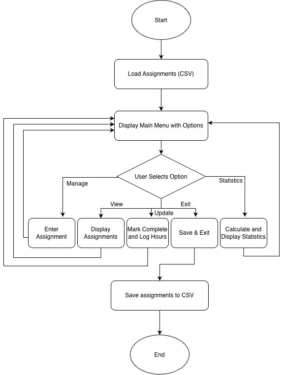

# Student Productivity Tracker

A program that allows users to enter information about assignments and due dates, and organizes them and gives information about productivity.

## The Problem

For students, it becomes difficult to keep track of assignments and time management when tasks for each class pile up. Although traditional to-do lists and calendars help organize assignments, they don't provide valuable insight into workload, completion rates, or productivity and habits. Often times students will end up missing easy assignments because, without a clear picture of assignment completion rates and study habits, it can be difficult to recognize patterns, manage time effectively, and stay on top of coursework.

## How It Works

- Users navigate a main menu with options to add assignments, view assignments, mark assignments complete, view productivity, or save and exit.
- When adding an assignment, users enter its name, course, due date, and expected completion time.
- When viewing assignments, users see all entered assignments and their completion status.
- Users can mark unfinished assignments as completed.
- The productivity option displays the assignment completion rate: the percentage of all assignments marked complete.
- After each action, users return to the main menu to select another option.
- Selecting “Save and Exit” saves assignment information and closes the program.



## Tech Stack

- **Language:** Java
- **Libraries:** ArrayList, LocalDate, IO, HashMap
- **External tools:** No external tools will be used.

## Setup

### Prerequisites
- Install Git.
- Install the Java Development Kit (JDK).

### Download the Project
```bash
git clone https://github.com/KimbEagle/Student-Productivity-Tracker.git
cd Student-Productivity-Tracker
```

The program is still under development and files have not been created yet. Instructions will be uploaded once the main Java class is implemented.

## Usage

Once implemented, the program will display a main menu with options to do the following:
- Add assignments.
- View assignments.
- Mark assignments as completed.
- View the assignment completion rate.
- Save and exit.
  
## Roadmap

- [ ] Graphical user interface
- [ ] Displaying productivity using graphs and charts
- [ ] Filtering assignments by course or completion status
- [ ] Calculating extra productivity statistics
- [ ] Weekly or class-specific productivity trends

## Author

Kim Eagle, https://github.com/KimbEagle.
