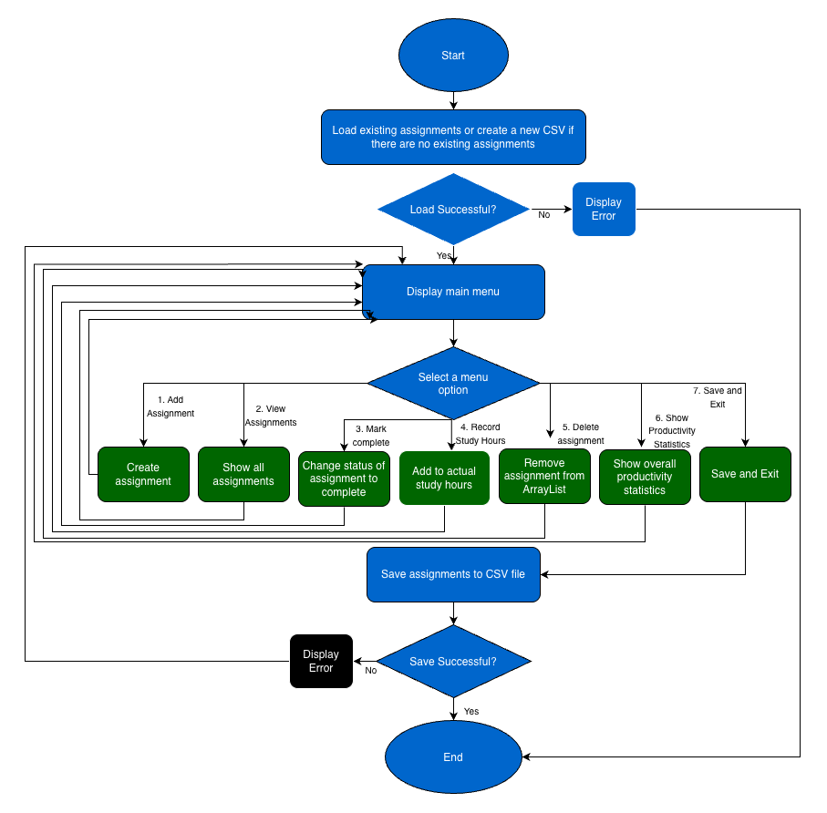

# Student Productivity Tracker

A terminal-based Java application that helps students manage assignments, track study hours, and analyze their productivity.
## The Problem

For students, it becomes difficult to keep track of assignments and manage time when tasks for each class pile up. Although traditional 
to-do lists and calendars help organize assignments, they do not provide valuable insight into workload, completion rates, 
or study habits. Without a clear picture of assignment progress and productivity, students may struggle to recognize patterns, manage their time effectively, and stay on top of coursework, sometimes missing even simple assignments.

## How It Works

- Previously saved assignments are automatically loaded from a local CSV file when the program starts.
- Users navigate an interactive main menu with seven options.
- When adding an assignment, users enter its name, course, due date, and estimated study time.
- When viewing assignments, users see assignment details, deadlines, estimated hours, actual hours, and completion statuses.
- Users can mark unfinished assignments as completed.
- Users can record actual study hours across multiple study sessions for each assignment.
- Users can delete unwanted or canceled assignments after confirming their selection.
- Users can view productivity statistics, including assignment counts, completion percentage, and total estimated versus actual study hours.
- After each action, users return to the main menu to select another option.
- Choosing Save and Exit saves all assignments to a local CSV file and closes the program if saving succeeds.
- Input validation and error handling help prevent invalid assignment data and protect previously saved information.



## Tech Stack

- **Language:** Java 26
- **Java standard library:** ArrayList, LocalDate, Scanner, BufferedReader, BufferedWriter, FileReader, FileWriter
- **Console input/output:** Scanner and Java IO
- **Storage:** In-memory ArrayList and local CSV file
- **Development tools:** IntelliJ IDEA, Git, GitHub
- **External dependencies:** None

## Setup

### Prerequisites

- Install Git.
- Install the Java Development Kit (JDK 26).
- A terminal or Java IDE such as IntelliJ IDEA.


### Download the Project

```bash
git clone https://github.com/KimbEagle/Student-Productivity-Tracker.git
cd Student-Productivity-Tracker
```

### Compile and Run

From the project's directory, compile the Java files:

```bash
javac -d out src/*.java
```

Run the program:

```bash
java -cp out Main
```

The program will display an interactive menu in the terminal.

## Usage

The program displays an interactive main menu where users
can select an option by entering its corresponding number.

### Example Usage

The following example demonstrates adding an assignment and 
viewing productivity statistics when starting with an empty assignment list.

```text
Enter your choice: 1
Enter assignment name: Math Homework
Enter course name: Calculus
Enter due date (YYYY-MM-DD): 2026-12-05
Enter estimated hours: 2

Assignment added successfully!
Total assignments: 1
```

After recording 2.5 actual study hours and marking the
assignment as completed, the user can select option 6
to view their productivity statistics.

```text
PRODUCTIVITY STATISTICS
Total assignments: 1
Completed assignments: 1
Incomplete assignments: 0
Completion percentage: 100.0%
Total estimated hours: 2.00
Total actual hours: 2.50
```

### Currently Implemented
- Add assignments with a name, course, due date, and estimated study time.
- Validate assignment information and handle invalid input.
- View all assignments, deadlines, and completion statuses.
- Exit the program.
- Mark assignments as completed.
- Record actual study hours across multiple study sessions.
- Save assignment information to a local CSV file.
- Automatically load previously saved assignments when the program starts.
- Delete assignments with confirmation.
- Calculate and display basic productivity statistics.

### Data Storage

Assignment data is stored locally in `assignments.csv`.
The program automatically loads saved assignments on startup
and saves updated information when the user selects Save and Exit.

If no CSV file exists, the program starts with an empty assignment
list. If an error occurs while loading existing data, the program
stops to prevent accidentally overwriting saved assignments.

## Roadmap

### MVP Features
- [x] Set up GitHub repository and Java project
- [x] Create Assignment class with assignment attributes
- [x] Implement assignment storage using ArrayList
- [x] Implement assignment creation with input validation
- [x] Display assignments and their due dates
- [x] Allow users to mark assignments as completed
- [x] Allow users to record actual time spent on assignments
- [x] Save assignment data to CSV file
- [x] Load assignments from CSV file on program start

### Additional Improvements
- [x] Delete unwanted or canceled assignments

### Schedule Features
- [x] Calculate and display basic productivity statistics
- [ ] Filter assignments by course or completion status
- [ ] Display weekly or class-specific productivity trends
- [ ] Display productivity using graphs and charts
- [ ] Develop a graphical user interface

## Demo Video

The video walkthrough will be added before final submission.

## Author

Kim Eagle, https://github.com/KimbEagle.
